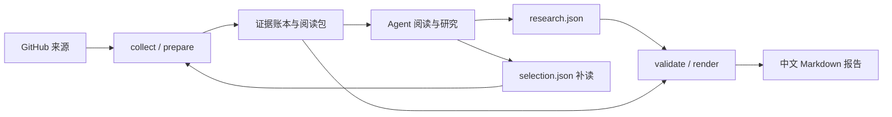

# Repository Evolution Research

**把一个 GitHub 项目最近的技术变化，整理成有来源、能核查、说明局限的研究报告。**

[English](README.en.md) · [使用工作流](skills/repo-evolution-research/references/workflow.md) · [贡献指南](CONTRIBUTING.md) · [MIT License](LICENSE)

这是一套面向编码 Agent 的研究 Skill，附带本地 Python CLI。它从 PR、Issue、RFC、Discussion、Release 和文档中收集材料，保存证据账本，让 Agent 研究项目的技术方向、设计取舍、实现进展和未解决问题，再校验引用与状态并生成中文报告。

适合刚接触一个开源项目、准备参与贡献，或希望持续理解项目技术演进的开发者。

> 当前工具版本：`0.2.8`；快照 schema：`1.3`。项目处于早期开发阶段，运行方式是源码目录调用，目前不提供独立的 pip 安装包。

## 你可以用它回答什么

- 过去三个月，维护者主要在解决哪些技术问题？
- 某个 RFC 的动机是什么，哪些子能力已有实现，哪些仍在讨论？
- 架构、调度、缓存或推理路径发生了什么变化，有哪些设计取舍？
- 哪些功能已合并，哪些有发布证据，哪些场景仍缺少验证？
- 想理解某个方向，应按什么顺序阅读哪些关键材料？

例如，在支持该 Skill 的 Agent 中提出：

```text
使用 $repo-evolution-research 研究 vllm-project/vllm 最近 90 天的技术演进，
重点关注调度和 KV cache。解释设计动机、实现进展、未解决问题，
区分已合并与已发布，并给出可核查的来源和推荐阅读顺序。
```

## 工作方式

CLI 负责确定性的采集、存储、归一化、校验和渲染；Agent 负责阅读、选择补充材料、组织主题和撰写研究判断。CLI 本身不会调用模型，也不会自动完成研究写作。



研究结果保留三类信息：

| 内容 | 作用 |
| --- | --- |
| 来源与证据 | 保存原始文本、内容 hash、URL 和引用位置，支持回到原文核查 |
| 能力与状态 | 分别记录提案、实现、发布和可用性；保留未知与矛盾 |
| 覆盖与局限 | 披露采集预算、截断、未读取材料和未验证场景 |

自动校验检查结构、引用、引文定位和状态规则。**通过校验不代表语义解释正确**，研究结论仍需要阅读与复核。

## 快速开始

### 1. 准备环境

- Python **3.11+**。
- **macOS 或 Linux**；存储锁使用 `fcntl`，原生 Windows 当前不支持，Windows 用户可使用 WSL。
- [GitHub CLI `gh`](https://cli.github.com/)，以及可访问目标仓库的 GitHub 账号认证。
- 要完成研究写作，需要能读取本地文件和运行命令的 Agent；也可以手工按照 schema 编写研究数据。

```bash
git clone https://github.com/zjbpaul1317/repo-evolution-research.git
cd repo-evolution-research
python3 -m venv .venv
source .venv/bin/activate
python -m pip install 'jsonschema>=4.23,<5'
gh auth login
python skills/repo-evolution-research/scripts/research.py doctor --repo vllm-project/vllm
```

`doctor` 检查 Python、依赖、格式校验器、`gh` 认证和仓库访问权限。关键检查失败时退出码为 `3`，请先修复环境。

### 2. 让 Agent 使用 Skill

Skill 的完整目录是 [`skills/repo-evolution-research/`](skills/repo-evolution-research/)，入口为 [`SKILL.md`](skills/repo-evolution-research/SKILL.md)。让支持本地 Skill 的宿主加载这个完整目录，保留 `scripts/`、`assets/`、`references/` 和 `agents/`。

在 Codex 中，可以向内置的 skill-installer 提出：

```text
请使用 $skill-installer，从 https://github.com/zjbpaul1317/repo-evolution-research
安装 skills/repo-evolution-research 目录中的 Skill。
```

然后使用上面的自然语言研究请求。不同宿主的发现路径和重新加载方式不同，参见 [Codex 官方 Skill 文档](https://developers.openai.com/codex/skills/)。依赖需要安装到 Agent 实际调用的 Python 环境；如使用本仓库虚拟环境，可明确要求 Agent 使用 `.venv/bin/python`。

### 3. 理解 CLI 研究流程

以下命令从仓库根目录执行。先初始化一个小窗口，确认采集情况，再扩大研究范围：

```bash
python skills/repo-evolution-research/scripts/research.py init \
  --repo vllm-project/vllm --days 30 --mode quick \
  --timezone Asia/Shanghai --focus scheduling --focus 'KV cache'
```

从输出 JSON 的 `result.run` 复制实际目录，替换下面的路径：

```bash
RUN='.repo-research/github.com/vllm-project/vllm/<run_id>'
python skills/repo-evolution-research/scripts/research.py collect --run "$RUN"
python skills/repo-evolution-research/scripts/research.py prepare --run "$RUN"
```

此时需要 Agent 阅读 `analysis/packs/*.md` 和候选材料。需要补读时，由 Agent 按 [selection 协议](skills/repo-evolution-research/references/workflow.md#selection-协议) 写入 `analysis/selection.json`，再执行：

```bash
python skills/repo-evolution-research/scripts/research.py collect \
  --run "$RUN" --selection "$RUN/analysis/selection.json"
python skills/repo-evolution-research/scripts/research.py prepare --run "$RUN"
```

Agent 完成研究并写入 `analysis/research.json` 后，才能执行：

```bash
python skills/repo-evolution-research/scripts/research.py validate --run "$RUN"
python skills/repo-evolution-research/scripts/research.py render --run "$RUN"
```

最终输出为 `$RUN/report.md`；辅助输出包括 `analysis/validation.json`、`analysis/evidence-review.md` 和 `analysis/render-report.json`。需要检查旧快照时可使用只读命令 `audit --run "$RUN"`。

| 模式 | 默认窗口 | 默认深读实体预算 | 使用场景 |
| --- | --- | --- | --- |
| `quick` | 30 天 | 12 | 初步认识、小范围探索 |
| `standard` | 90 天 | 40 | 一次常规技术演进研究 |
| `deep` | 180 天 | 80 | 更长窗口、更大阅读预算 |

显式传入的日期、天数和预算覆盖模式默认值。完整参数见 [配置参考](skills/repo-evolution-research/references/configuration.md)。这些数字是采集预算，不保证覆盖整个仓库。

## 示例与验证

先看 [离线示例报告](tests/fixtures/loop/report.golden.md)：它展示主题、能力状态、脚注证据、阅读索引和覆盖局限。该示例使用虚构的 `acme/demo` 和 fake GitHub 数据，链接不代表真实项目。

无需 GitHub 认证，可以运行确定性的完整流程测试：

```bash
python -m pip install 'pytest>=8'
python -m pytest tests/test_offline_loop.py -q
```

测试使用 fake GitHub transport，覆盖采集、准备、Agent 数据写入、校验、渲染和 golden report 比较。真实来源案例见 [vLLM KV correctness](evals/cases/vllm-20261104-kv-correctness/notes.md)，其公开来源摘录和测试可离线检查；完整快照回放需要另行提供原始 run。

这个真实案例仅覆盖四份 PR，标注和 baseline 由同一 Agent 会话完成，尚非独立人工盲评，也不代表完整仓库研究质量。

## 当前边界

- 报告当前固定为中文；`--language` 和 `--compare-previous` 是保留参数，尚不提供多语言报告或跨窗口对比。
- PR 的文件列表和 patch 片段可能截断；当前不采集完整 diff，不执行目标项目测试，也不验证实际部署性能。
- 合并、发布和可用性分别判断；Release 提及或 PR 作者的 benchmark 不能自动成为本项目独立验证的结果。
- 受 API 访问权限、分页、速率限制和预算约束，采集可能部分完成；退出码 `4` 表示需要检查缺口或恢复步骤，不能直接忽略。
- `validate` / `render` 门禁失败时退出码为 `5`；零证据快照不能生成正式报告。
- 快照兼容范围有限；升级前保留原始 run，通过 `audit` 检查，并按 [恢复流程](skills/repo-evolution-research/references/workflow.md#只读升级诊断与副本恢复) 在副本操作。

## 项目结构

```text
skills/repo-evolution-research/
  SKILL.md           Agent 入口与研究边界
  scripts/           Python CLI、采集器、证据与报告逻辑
  assets/            JSON schemas、配置和报告模板
  references/        工作流、来源、状态与评测契约
tests/               离线回归、fixture 与 golden report
evals/               质量评测器、标注规范与公开案例
docs/                贡献者和维护者文档
scripts/             资产生成和 lint 工具
```

研究快照默认保存到 `.repo-research/`，运行结果保存到 `evals/results/`；开发过程档案放在 `.local/`。这些目录均被 Git 忽略。自定义 `--output-root` 时请自行确认该目录不会进入公开提交。

## 开发与贡献

```bash
python -m pip install 'jsonschema>=4.23,<5' 'pytest>=8' 'ruff>=0.6' 'PyYAML>=6'
python -m pytest -q
python scripts/gen_assets.py --check
PYTHON=python bash scripts/lint.sh
```

CI 在 Linux 和 macOS、Python 3.11 和 3.13 上运行这些离线检查，无需仓库密钥或实时 GitHub API。当前本地验证结果和 CI 运行结果应分别核实。

欢迎提交 bug、研究质量问题、来源采集改进和文档修正。请先阅读 [贡献指南](CONTRIBUTING.md)、[采集器开发契约](docs/collector-authoring.md) 和 [安全说明](SECURITY.md)。维护与发布建议见 [维护指南](docs/maintaining.md)。

## 许可证与来源

项目原创代码和文档使用 [MIT License](LICENSE)。第三方 PR、Issue、文档摘录及其权利归属见 [第三方内容说明](THIRD_PARTY_NOTICES.md)。采集与发布研究材料时，请保留来源、遵守对应许可，并复核是否包含非公开信息。
